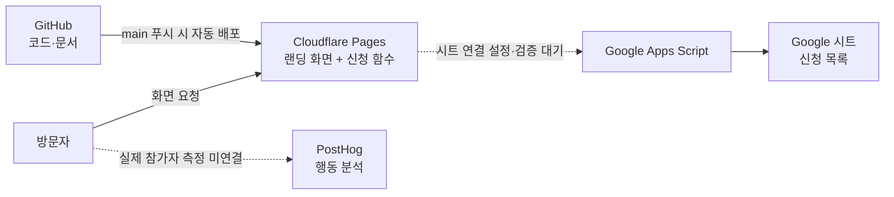

# PLAN:CHECK 랜딩페이지 실험

공모전 참가자가 제출 전 기획안 피드백에 관심이 있는지 알아보기 위한 팀 프로젝트입니다. 서비스와 실험을 준비하고 있으며, 실제 기획안 분석이나 결제 기능은 없습니다.

**[테스트 화면 열기](https://contest-feedback-landing.pages.dev/)** · [팀원을 위한 안내](docs/team-introduction.md) · [실험 준비 현황](docs/experiment-readiness.md)

> 이 주소는 **누구나 볼 수 있는 테스트 화면**입니다. 현재 사전 신청은 시트에 연결되어 있지 않아 저장되지 않습니다. 실제 이메일은 입력하지 말아 주세요. 실제 참가자의 행동도 PostHog에 기록되지 않습니다.

## 무엇을 확인하려고 하나요?

팀이 만든 시안을 바탕으로 아래 흐름을 준비합니다.

**커뮤니티 게시글 → 랜딩페이지 방문 → 샘플 리포트 확인 → 이메일 사전 신청**

화면 순서는 표지, 공감, 이용 방법, 샘플 리포트, 사전 신청, FAQ입니다. 샘플은 가상의 예시입니다. 현재 원본과 구현 화면에는 구매 버튼이 없으며 실제 결제도 받지 않습니다.

## 현재 어디까지 됐나요?

| 항목 | 현재 상태 |
| --- | --- |
| 랜딩 화면 | 팀이 전달한 ZIP의 내용·구성을 바탕으로 React 화면 연결. 테스트 주소에 배포 |
| 샘플 리포트 | 가상의 예시. 확대·목차 등 확인 가능 |
| 이메일 신청 | 로컬에서 가상 신청이 Google 시트에 저장되는 것을 확인. **배포된 화면과 시트의 연결은 아직 안 됨** |
| PostHog | 로컬 개발자 테스트의 방문·신청 시작·완료 이벤트 도착 확인. **실제 참가자 측정은 꺼져 있음** |
| 공개 범위 | 테스트 화면과 GitHub 저장소는 공개. 신청 시트는 별도 권한이 필요 |
| 자동 배포 | GitHub `main`에 푸시하면 Cloudflare에서 테스트 화면을 자동으로 다시 배포 |

현재 화면은 팀 전달 시안을 기반으로 하며, 원본 HTML을 React에서 연결하고 일부 상호작용은 기존 스크립트 어댑터를 사용합니다. 모든 영역이 React 컴포넌트로 새로 작성된 것은 아닙니다. 실제 분석·제공 상태를 알 수 있도록 공개 실험 전 화면 안내와 운영 조건을 점검해야 합니다.

## 데이터는 어디로 가나요?



PostHog는 방문·샘플 확인 등 **행동을 분석**하는 도구이고, Google 시트는 팀이 **신청 이메일을 확인**할 곳입니다. 이메일을 PostHog로 보내지 않도록 설계했습니다. 로컬에서 테스트한 경로와 실제 배포된 사이트의 연결 상태는 구분합니다. 자세한 설명은 [기술 구조](docs/technical-architecture.md)와 [사전 신청 설계](docs/signup-design.md)를 확인하세요.

## 팀원은 무엇을 보면 되나요?

1. [테스트 화면](https://contest-feedback-landing.pages.dev/)에서 화면 순서와 샘플을 확인합니다. 실제 이메일이나 기획안은 입력하지 않습니다.
2. [팀 안내](docs/team-introduction.md)에서 현재 가능한 기능과 PostHog의 역할을 확인합니다.
3. 화면이나 문구에 의견이 있으면 개발자에게 전달합니다. 팀원이 코드를 실행할 필요는 없습니다.

GitHub는 공개 저장소라 누구나 문서를 볼 수 있습니다. 코드를 수정할 권한, PostHog 프로젝트 접근 권한, 신청 시트 접근 권한은 각각 별도로 관리합니다.

## 개발자가 로컬에서 실행하기

Node.js 24 이상, npm과 Git이 필요합니다. 처음 한 번 저장소를 내려받고 실행합니다.

```bash
git clone https://github.com/HelloMyMe-M1-2/contest-feedback-landing.git
cd contest-feedback-landing
npm install
npm run dev
```

터미널에 표시되는 `http://127.0.0.1:...` 주소를 열고, 종료할 때는 터미널에서 `Ctrl+C`를 누릅니다. Vite 개발 서버만 실행하면 신청 API는 동작하지 않습니다. 서버 함수 테스트는 [사전 신청 설계](docs/signup-design.md)를 참고하세요.

검증 명령:

```bash
npm test
npm run build
```

로컬의 행동 기록 실습장은 개발 서버의 `/__analytics` 경로에서 열 수 있습니다. PostHog로 테스트 이벤트를 보내려면 별도 설정이 필요하며 방법은 [PostHog 안내](docs/posthog-guide.md)에 있습니다. `.env.local`, `.dev.vars`, 이메일, 비밀값은 GitHub에 올리지 않습니다.

## 문서 안내

| 문서 | 무엇을 볼 수 있나요? |
| --- | --- |
| [팀원을 위한 안내](docs/team-introduction.md) | 현재 화면, PostHog와 시트의 역할 |
| [실험 정리](docs/experiment.md) | 실험 목적과 결과를 읽는 방법 |
| [실험 준비 현황](docs/experiment-readiness.md) | 확인된 것과 실제 수집 전 남은 일 |
| [작업 기록](docs/project-history.md) | 구상부터 현재 테스트 배포까지의 흐름 |
| [이벤트 명세](docs/events.md) | 각 행동의 기록 조건과 해석 |
| [PostHog 대시보드](docs/posthog-dashboard.md) | 결과를 보는 방법과 CSV 내보내기 |
| [사전 신청 설계](docs/signup-design.md) | 이메일 저장 흐름과 오류 처리 |
| [기술 구조](docs/technical-architecture.md) · [C4 구조](docs/c4-architecture.md) | 화면·서버·외부 서비스 연결 |
| [화면 이전 기록](docs/migration-notes.md) | 팀 전달 시안을 코드에 연결한 방식 |
| [팀 작업 방식](docs/team-work.md) | 수정·검토·공유 방법 |

이전 시안에 대한 화면 캡처와 디자인 검토 기록은 당시 자료입니다. 현재의 화면과 이벤트는 위 문서와 테스트 주소를 기준으로 확인합니다.
