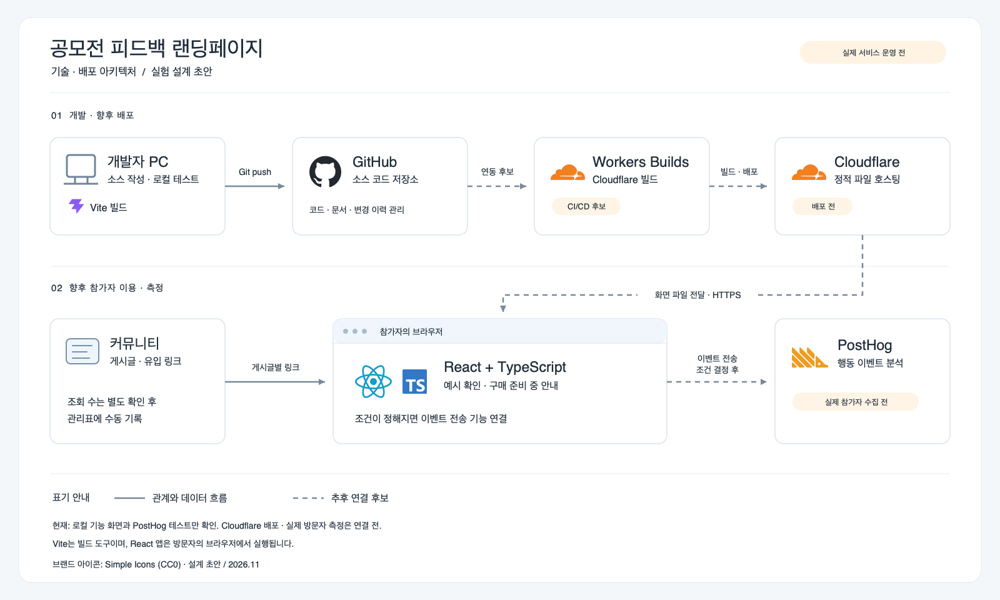

# 공모전 기획안 피드백 — 랜딩페이지 실험

공모전 참가자가 제출 전 기획안 피드백에 관심이 있는지 알아보기 위한 팀 프로젝트입니다. **실제 서비스를 운영하는 단계가 아니라 실험을 준비하는 단계**입니다.

> **지금은 무엇을 볼 수 있나요?** 개발자 컴퓨터에서 팀이 전달한 원본 랜딩 화면과 가상의 피드백 예시를 확인할 수 있습니다. 현재 원본에는 구매 버튼이 없습니다.
>
> **아직 안 되는 것은 무엇인가요?** 실제 기획안 분석, 이메일 저장, 실제 결제, 방문자 데이터 수집과 공개 배포는 준비되지 않았습니다. PostHog에는 개발자가 보낸 **테스트 데이터**만 도착한 것을 확인했습니다.

## 사전 신청 연결 방향 업데이트

팀 합의에 따라 개인 Google 시트와 Apps Script 연결을 설계했습니다. 기존 신청 API는 아직 이전 서비스 계정 방식이며 새 방식은 미구현·미배포입니다. 자세한 내용은 [사전 신청 설계](docs/signup-design.md)를 확인하세요.

## 2026-11-20 이후 로컬 작업 상태

팀에서 전달한 PLAN:CHECK 시안의 HTML과 스타일을 React 화면에 연결하고 사전 신청 폼을 추가했습니다. 원본 상호작용은 임시 어댑터로 유지하고 있어 **React 컴포넌트로의 완전한 이전은 아직 진행 중**입니다. 팀 검토용 원본 문구에는 제공 여부가 검증되지 않은 표현이 있으므로 실제 참가자에게 공개하기 전 별도 확인이 필요합니다.

사전 신청은 `/api/signup`과 Google 스프레드시트 저장 코드가 준비돼 있지만, 로컬 Vite에서는 API가 실행되지 않고 실제 시트와 인증 정보도 연결되지 않았습니다. 실제 이메일을 제출하지 마세요. 연결 방법은 [사전 신청 설계](docs/signup-design.md)를 참고하세요. PostHog의 실제 참가자 측정도 미연결입니다. 아래 기존 안내 및 스크린샷은 변경 전 자료가 포함되어 있습니다.

색상은 `src/plancheck/original.css`의 `:root`, 폰트는 `src/plancheck/prototype.css`의 `--site-font`에서 조정합니다.

## 왜 만드는 건가요?

아이디어·기획 공모전 참가자는 제출 전에 기획안에서 부족한 근거나 놓친 부분을 확인하고 싶어 할 수 있습니다. 우리는 기획안의 어떤 부분이 부족한지와 그 이유, 참고한 평가 기준을 보여주는 피드백 서비스를 구상하고 있습니다. 이 서비스의 효과는 아직 검증되지 않았습니다.

이번 실험에서는 나중에 아래 흐름을 살펴보려고 합니다.

**커뮤니티 게시글 → 랜딩페이지 방문 → 샘플 리포트 확인 → 사전 신청**

사전 신청 이메일은 팀이 볼 수 있는 Google 시트로 저장하는 방향입니다. 아직 연결되지 않아 실제 신청은 받을 수 없습니다. 현재 원본에는 구매 버튼이 없습니다.

### 결과를 볼 때 주의할 점

- **구매 버튼 클릭은 관심 또는 구매 의사의 신호**입니다. 실제 결제나 구매 완료를 뜻하지 않습니다. 가격이 정해지지 않은 상태에서의 클릭이라면 가격을 모르는 상태의 관심입니다.
- 게시글 조회 수는 커뮤니티에서 확인해 따로 기록해야 합니다. 랜딩페이지에서 측정할 방문 수와는 같은 사람이 중복 없이 집계된 숫자가 아닙니다.
- 페이지가 화면에 표시된 시간은 측정할 수 있지만, 그 시간 동안 내용을 실제로 읽었다고 단정할 수 없습니다.

## 지금 어디까지 준비됐나요?

2026-11-20 로컬 작업: 팀이 전달한 PLAN:CHECK 시안의 구역 순서를 반영했습니다. 색상과 폰트는 `src/plancheck.css`의 변수에서 변경할 수 있습니다. 샘플 이미지와 문구는 가상의 예시입니다. 사전 신청 화면과 저장 API 초안을 추가했지만 저장소가 연결되지 않아 실제 이메일은 접수되지 않습니다. ZIP 원본 화면의 React 이전은 아직 완료되지 않았습니다. 실험 참가자의 실제 행동 수집은 아직 연결되지 않았습니다.

| 항목 | 현재 상태 |
| --- | --- |
| 화면과 문구 | 팀 전달 시안을 바탕으로 한 로컬 화면. 색상과 폰트는 변경 가능 |
| 피드백 예시 | 가상의 예시. 실제 기획안 분석 결과가 아님 |
| 구매 버튼 | 현재 원본에 없음. 실제 결제도 제공하지 않음 |
| 이메일 사전 신청 | 폼은 있으나 Google 시트 미연결. 실제 이메일 접수 불가 |
| 행동 측정 | 개발자의 로컬 테스트만 가능. 실제 참가자 측정은 연결되지 않음 |
| 웹사이트 배포 | Cloudflare를 사용하기로 했지만 계정 연결과 배포는 아직 하지 않음 |
| 실험 내용 | 가격, 제공 범위, 게시 장소·기간과 최종 문구는 미정 |

**로컬**은 내 컴퓨터에서만 실행한다는 뜻입니다. GitHub에 코드가 올라가는 것과 웹사이트가 인터넷에 공개되는 것은 별개의 일입니다. 따라서 이 저장소의 화면을 직접 눌러 보려면 현재는 아래 실행 방법이 필요합니다.

## 사이트는 어떻게 연결되나요?

아래 그림은 **앞으로의 구조를 설명하는 초안**입니다. 점선으로 표시한 배포와 실제 참가자 측정은 아직 연결되지 않았습니다.



쉽게 말하면 React는 사용자가 보는 화면을 만들고, Cloudflare는 그 화면을 전달하며, PostHog는 나중에 조건이 정해진 행동을 분석하는 도구입니다. 이메일 저장에는 별도의 서버 역할이 필요해 Cloudflare와 Google Apps Script를 연결하는 방식을 설계 중입니다. 아직 연결·배포하지 않았습니다.

그림에서 사용한 GitHub–Cloudflare 자동 배포는 후보일 뿐 설정하거나 확정하지 않았습니다. 그림에는 이전 설계가 남아 있어 현재 이메일 저장 방향과 다를 수 있습니다. 현재 신청 저장 방향은 [사전 신청 설계](docs/signup-design.md), 측정 기준은 [이벤트 명세](docs/events.md), 결과를 볼 방법은 [PostHog 대시보드 안내](docs/posthog-dashboard.md)를 참고하세요.

## 팀원은 무엇을 하면 되나요?

먼저 [팀원을 위한 프로젝트 안내](docs/team-introduction.md)를 열어 현재 랜딩페이지와 PostHog 테스트 화면을 이미지로 볼 수 있습니다.

**코드를 실행하지 않아도 프로젝트를 검토할 수 있습니다.** 팀에서 결정할 항목과 예시·문구를 보고 의견을 주면 됩니다.

1. 위의 **현재 상태**를 보고 준비된 것과 아직 결정되지 않은 것을 확인합니다.
2. [실험 정리](docs/experiment.md)에서 실험 목적과 팀이 정할 항목을 살펴봅니다.
3. 화면 디자인과 문구가 준비되면 개발자와 전달 방법을 정합니다. 현재 화면은 최종 디자인이 아닙니다.
4. 변경 사항을 검토할 때는 “무엇이 달라지는지, 왜 바꾸는지, 아직 안 되는 것은 무엇인지”를 확인합니다. 자세한 방법은 [팀 협업 안내](docs/team-work.md)를 참고하세요.

이 저장소는 공개되어 있어 누구나 코드와 문서를 볼 수 있습니다. 저장소에 직접 변경 사항을 올리려면 별도의 권한이 필요합니다. 앞으로 만들 미리보기나 사이트 주소의 공개 범위는 저장소와 별도로 확인해야 합니다. **코드를 수정하거나 터미널을 사용할 필요가 있는 사람만** 아래 실행 안내를 보면 됩니다.

## 내 컴퓨터에서 임시 화면 열기

팀원이 코드를 직접 실행해 보고 싶을 때 사용하는 방법입니다. 아래 명령을 실행해도 사이트가 인터넷에 공개되지는 않습니다. 설치가 어렵다면 개발자에게 확인을 부탁해도 됩니다.

### 1. 준비하기

- Node.js **24 이상**, npm, Git이 필요합니다. npm은 보통 Node.js를 설치할 때 함께 설치됩니다.
- 터미널을 열고 아래 두 명령을 한 줄씩 실행해 설치 여부를 확인합니다. `node`의 버전이 `v24` 이상인지 확인합니다.

```bash
node --version
npm --version
```

- 공개 저장소이므로 코드를 내려받아 확인하는 데 초대는 필요하지 않습니다. 저장소에 직접 변경 사항을 올리려면 개발자에게 문의하세요.

### 2. 코드 내려받고 실행하기

**처음 내려받는 경우에만** 터미널에서 작업할 폴더로 이동한 뒤 실행합니다.

```bash
git clone https://github.com/HelloMyMe-M1-2/contest-feedback-landing.git
cd contest-feedback-landing
```

이미 내려받았다면 다시 복제하지 말고 터미널에서 기존 `contest-feedback-landing` 폴더를 엽니다. 그다음 아래 명령을 한 줄씩 실행합니다.

```bash
npm install
npm run dev
```

첫 번째 명령은 필요한 패키지들을 설치하고, 두 번째 명령은 **내 컴퓨터에서만 확인할 수 있는 개발 서버**를 시작합니다. 터미널에 표시되는 `http://127.0.0.1:...` 주소를 브라우저에 입력해 화면을 엽니다. 포트 번호는 사용 환경에 따라 달라질 수 있습니다.

확인을 마치면 개발 서버가 실행 중인 터미널을 선택하고 **Ctrl+C**를 누릅니다. 명령을 찾을 수 없거나 저장소 접근이 거부되면 오류 문구를 개발자에게 전달해 주세요. 비밀번호나 토큰은 공유하지 마세요.

### 3. 화면에서 확인하기

1. 샘플 리포트의 목차와 확대 기능을 살펴봅니다.
2. 사전 신청 폼과 개인정보 안내를 확인합니다. 실제 이메일은 입력하지 않습니다.
3. 원본 시안의 구성과 동작을 검토하고 필요한 의견을 정리합니다.

일반 주소로 볼 때는 행동 데이터가 PostHog로 전송되지 않습니다. PostHog 전송은 개발자가 별도 설정하고 테스트 주소를 연 경우에만 동작합니다. 실제 이메일, 기획안 또는 개인정보로 테스트하지 않습니다.

### 행동 기록을 연습하려면

개발 서버가 실행 중일 때 **별도의 이벤트 실습장**을 먼저 엽니다. 예를 들어 터미널에 `http://127.0.0.1:5173/`이 표시되었다면 아래 주소를 엽니다.

```text
http://127.0.0.1:5173/__analytics
```

포트가 `5173`이 아니라면 터미널에 나온 번호를 사용합니다. 실습장에서 **랜딩페이지 열기**를 누르면 새 탭에 랜딩페이지만 열립니다. 새 탭에서 샘플을 확인하거나 이메일 입력란을 누른 뒤 실습장 탭으로 돌아오면 연습 기록을 볼 수 있습니다.

실습장을 먼저 열어야 이후 기록을 받을 수 있습니다. 두 탭은 같은 브라우저 프로필과 같은 호스트·포트를 사용해야 합니다. 기록은 실습장 메모리에 최대 100개만 남고 새로고침하면 사라집니다. 서로 다른 방문은 페이지 ID로 구분하며 실제 사람 수와는 다릅니다.

PostHog에 실제로 테스트 이벤트를 보내는 것은 별도 설정이 필요한 선택 사항입니다. 원리와 방법은 [PostHog 처음 사용하기](docs/posthog-guide.md)를 참고하세요.

| 로컬 접속 방식 | 확인할 수 있는 내용 |
| --- | --- |
| 기본 주소 | 임시 랜딩 화면. PostHog 전송 없음 |
| 별도 실습장에서 **랜딩페이지 열기** | 랜딩 탭의 테스트 행동을 실습장 탭에서 확인. PostHog 전송 없음 |
| 별도 실습장에서 **PostHog 테스트로 열기** 및 별도 설정 | 가상의 테스트 이벤트를 PostHog 프로젝트로 전송 시도. 도착 여부는 PostHog에서 확인 |

PostHog는 로컬 웹사이트도 측정할 수 있습니다. 마지막 방식은 토큰·호스트 설정과 로컬 테스트 조건이 충족되어야 하며, 전송 표시만으로 실제 도착이 보장되지는 않습니다. 테스트 기록이 프로젝트에 남을 수 있으므로 실제 실험 결과와 구분해야 합니다.

<details>
<summary>개발자를 위한 검사 명령과 파일 안내</summary>

```bash
npm test        # 이벤트와 유입 정보 관련 자동 검사
npm run build   # 타입 검사와 배포용 파일 생성
npm run preview # 빌드 후 결과를 로컬에서 확인
```

`npm install`에는 패키지 서버 접근이 필요합니다. 잠금 파일 기준으로 설치할 때는 `npm ci`를 사용할 수 있습니다. 실제 토큰이나 비밀번호는 GitHub에 올리지 않습니다. `VITE_`로 시작하는 값은 브라우저에 노출될 수 있으므로 비밀 키를 넣지 않습니다.

| 위치 | 역할 |
| --- | --- |
| `src/App.tsx`, `src/components/` | 임시 화면과 가상의 피드백 예시 |
| `src/analytics/` | 이벤트 정의, 유입 정보, 로컬 측정·PostHog 테스트 |
| `tests/` | 자동 검사 코드 |
| `AGENTS.md` | 이 프로젝트를 작업하는 AI와 개발자를 위한 지침 |

</details>

## 문서 더 보기

| 궁금한 내용 | 문서 |
| --- | --- |
| 실험의 목적과 미결정 사항 | [실험 정리](docs/experiment.md) |
| 팀에서 변경 사항을 확인하는 방법 | [팀 협업 안내](docs/team-work.md) |
| PostHog의 기본 개념과 테스트 | [PostHog 처음 사용하기](docs/posthog-guide.md) |
| 무엇을 어떤 기준으로 측정하는지 | [이벤트 명세](docs/events.md) |
| 화면이나 PostHog 요구사항이 바뀔 때 | [측정 변경 안내](docs/measurement-change-guide.md) |
| 팀 검토용 디자인 기준 | [디자인 기준 초안](docs/design-system.md) |
| 디자인 도구 선택과 변경 근거 | [디자인 검토 기록](docs/design-review-2026-11-17.md) |
| 기술과 배포 연결 | [기술·배포 아키텍처](docs/technical-architecture.md) |
| 시스템과 내부 책임을 단계별로 보기 | [C4 아키텍처](docs/c4-architecture.md) |
| 전체 구조와 개인정보 검토 사항 | [아키텍처 초안](docs/architecture.md) |

## 앞으로의 순서

1. 현재 작성된 설계와 로컬 변경 사항을 검토합니다.
2. 팀에서 예시, 가격 여부, 제공 범위, 게시글과 문구를 구체화합니다.
3. 필요한 측정과 개인정보 처리 조건, 이메일 등록 필요성을 결정합니다.
4. 합의한 범위를 개발하고 가상 데이터로 검증합니다. 팀 디자인은 준비된 뒤 반영합니다.
5. 팀 검토 환경과 향후 공개 실험은 별도로 준비합니다. **지금은 운영하지 않습니다.**
