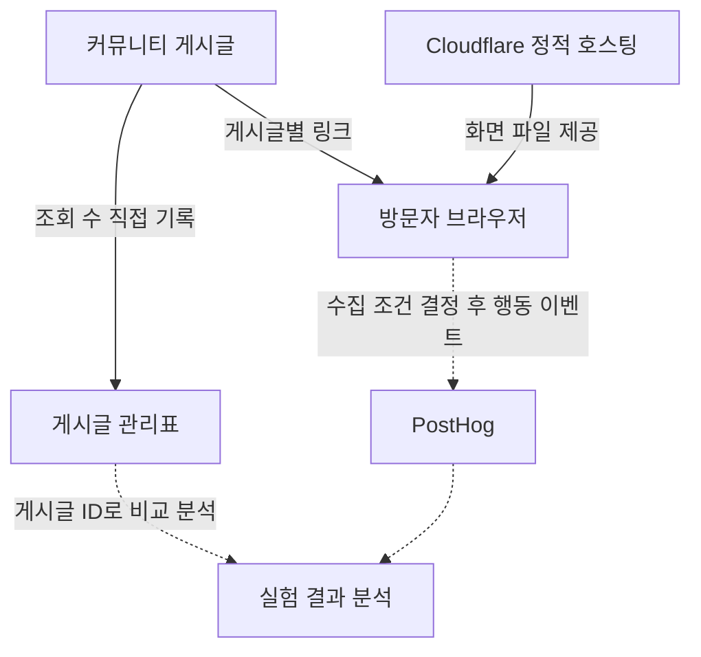

# 랜딩페이지 실험 아키텍처 초안

> 상태: 검토용 초안 · 2026-11-17. 실제 운영이나 배포를 시작한다는 의미가 아닙니다. 현재 코드와 앞으로의 제안을 구분해 읽어 주세요.

시스템 맥락·컨테이너·컴포넌트 수준의 그림과 현재 구현 상태는 [C4 아키텍처](c4-architecture.md)를 참고하세요.

## 1. 목적과 범위

아이디어·기획 공모전 참가자가 피드백 예시와 구매 제안에 관심을 보이는지 탐색합니다. 방문자에게 실제 분석, 피드백 리포트, 결제를 제공하지 않습니다. 구매 버튼을 누르면 서비스와 결제가 준비되지 않았다는 안내를 보여줍니다.

이메일 관심 등록과 구매 버튼은 독립적인 경로입니다. 이메일 수집은 연락 목적과 책임자, 보관·삭제 조건 등을 정하기 전까지 보류합니다. 이메일을 받지 않는 동안에는 등록 완료율을 측정할 수 없습니다.

## 2. 현재 상태와 제안의 차이

| 항목 | 현재 | 향후 제안 |
| --- | --- | --- |
| 화면 | React + Vite로 만든 기능 확인용 화면 | 팀이 정한 디자인을 적용하되 행동의 의미는 유지 |
| 배포 | Cloudflare 계정 연결·배포 전 | Cloudflare Workers 정적 호스팅 사용 |
| 행동 측정 | 브라우저 내 실습과 명시적으로 켠 로컬 PostHog 테스트 | 수집 항목과 개인정보 조건을 결정한 후에만 실험 연결 |
| 유입 구분 | 연습용 ID만 PostHog 테스트에 허용 | 실제 게시글마다 발급한 ID와 게시글 관리표를 연결 |
| 이메일·회원가입 | 수집·저장하지 않음 | 이메일 등록이 필요해지면 저장 방식 별도 결정 |
| 결제 | 구매 클릭 후 준비 중 안내 | 실제 결제 없이 관심 신호로만 분석 |

기존 PostHog 테스트 이벤트의 일부에는 설정 변경 전 IP와 위치 추정 정보가 남아 있습니다. 이후 IP 저장을 끄고 새 로컬 테스트에서는 GeoIP 비활성화를 요청했습니다. 이는 IP가 PostHog에 전달·처리되지 않는다는 보장은 아닙니다. 기존 기록의 처리와 실험 수집 설정은 별도로 검토합니다.

## 3. 제안하는 최소 구조

점선은 아직 실제 참가자에 대해 연결되지 않았거나 앞으로 수행할 작업입니다. 게시글 관리표는 스프레드시트나 표 형식 파일 등으로 관리할 수 있으며 도구는 미정입니다. 사이트 화면을 보여주는 Cloudflare와 브라우저가 분석 이벤트를 전달하는 PostHog는 서로 다른 역할입니다. Cloudflare 정적 파일 제공만으로 PostHog나 데이터베이스가 자동 연결되는 것은 아닙니다.

| 구성 요소 | 책임 | 선택 이유와 경계 |
| --- | --- | --- |
| 브라우저의 React 화면 | 소개, 가상 예시 선택, 구매 안내 표시 | 이미 구성되어 있고 화면과 행동 처리를 분리하기 좋음. React가 디자인의 신뢰성을 자동으로 높이지는 않음 |
| 이벤트 정의·기록 계층 | 예시 선택과 구매 클릭 등 행동의 의미와 속성 정의 | 문구·배치가 바뀌어도 같은 행동이면 같은 기준 사용. 도구 전송 코드와 구분 |
| Cloudflare Workers 정적 호스팅 | HTML·CSS·JS 파일 제공 | 별도의 서버 프로그램 없이 파일을 제공할 수 있음. 동적 API가 필요해지면 별도 설계 |
| PostHog | 허용된 이벤트 저장과 탐색 | 기존 프로젝트를 테스트에 사용 중. 실제 전송은 개인정보 처리와 수집 범위 결정 후 설계·검증 |
| 게시글 관리표 | 게시글 ID, 채널, 문구 버전, 게시 기간, 플랫폼 조회 수 기록 | 커뮤니티 조회 수는 사이트에서 직접 알 수 없고 플랫폼마다 집계 방식도 다름 |

최소 구조에서는 자체 백엔드 서버, 회원 계정, 이메일 데이터베이스, 결제 시스템을 두지 않습니다. PostHog는 이벤트를 저장하므로 데이터 저장 자체가 없는 것은 아닙니다. 현재는 실제 실험 데이터가 저장되지 않습니다.

### 왜 이 정도 구조인가요?

- **React + Vite 유지:** 단일 랜딩과 브라우저 이벤트에 충분하고 이미 초안이 있습니다. Next.js의 서버 렌더링과 서버 기능은 현재 필요성이 확인되지 않았습니다. 검색 유입이 중요해지거나 서버 기능이 필요해지면 Next.js를 다시 비교합니다. Vue도 가능하지만 지금 전환할 실험상 이점은 확인되지 않았습니다.
- **자체 백엔드 보류:** 구매 버튼 뒤에 저장하거나 결제할 일이 없어 자체 API가 필수는 아닙니다. 운영할 서버와 관리할 비밀값을 줄일 수 있습니다. 대신 외부 분석 도구에 대한 의존과 클라이언트 수집의 누락 가능성이 있습니다.
- **회원가입 보류:** 계정 생성은 사용자에게 추가 단계를 요구하고 인증·보안·복구 운영이 필요합니다. 현재 질문에는 구매 클릭과 독립적인 이메일 관심 등록이 더 가벼운 선택지입니다. 다만 이메일 자체도 수집 목적과 관리 기준이 필요합니다.
- **호스팅과 분석 분리:** 정적 호스팅은 화면 전달만 담당하고, 측정 도구는 조건이 정해진 행동만 별도로 받도록 합니다. PostHog 장애나 차단이 화면의 기본 기능을 막지 않아야 합니다.

## 4. 화면 변경과 측정의 경계

화면은 디자인 팀이 자유롭게 바꿀 수 있지만 측정하려는 행동의 정의를 함께 확인해야 합니다. 예를 들어 구매 버튼이 상단으로 옮겨져도 실제로 버튼을 누르는 행동은 `purchase_clicked`입니다. 버튼 클릭 횟수와 클릭한 페이지 방문 수는 별개입니다.

현재 테스트 코드의 이벤트와 발생 조건은 [이벤트 명세](events.md)가 기준입니다. 변경 전에는 다음을 검토합니다.

1. 행동의 의미가 같으면 이벤트 이름을 유지합니다. 배치·색상·문구는 이벤트 이름에 넣지 않습니다.
2. 예시와 구매 제안은 ID와 버전을 별도로 관리합니다. 가격이나 제공 범위가 바뀌면 그 변화를 구분해 해석합니다.
3. 발생 조건이나 의미가 바뀌면 명세와 스키마 버전, 테스트를 함께 바꿉니다. 과거와 같은 수치라고 자동으로 합치지 않습니다.
4. 예시 노출은 현재 로컬에서 요소 50% 이상이 2초 보일 때 기록합니다. 긴 콘텐츠나 작은 화면에서는 불리할 수 있으므로 최종 화면에 맞춰 기준을 다시 확인합니다.
5. 측정이 꺼져 있거나 전송에 실패해도 예시 보기와 구매 안내는 작동해야 합니다.

## 5. 측정과 데이터 흐름

**유입:** 게시글마다 식별자가 다른 링크를 사용합니다. 채널·문구·게시글 ID의 대응은 관리표에 보관합니다. 게시글 조회 수와 플랫폼이 제공하는 링크 클릭 수는 확인 가능한 경우 플랫폼에서 따로 기록합니다. 랜딩 방문은 사이트 이벤트로 측정합니다. 게시글 조회 대비 랜딩 방문 비율은 같은 관측 기간의 `해당 게시글 ID로 기록된 페이지 방문 수 ÷ 게시글 조회 수`입니다. 중복 방문, 공유, 플랫폼 집계 차이와 차단 때문에 서로 같은 사람의 숫자나 순수한 클릭률로 해석하지 않습니다.

**행동:** 한 페이지를 열 때 만든 `page_view_id`로 그 페이지의 방문·예시·구매 이벤트를 묶습니다. 새로고침은 새 페이지 방문이며, 사람이 같아도 브라우저·기기·재방문을 하나의 사람으로 확정할 수 없습니다. 클릭 총횟수와 클릭한 페이지 방문 수를 따로 봅니다. 별도의 방문자 수를 쓰려면 식별 방식과 동의·보관을 먼저 결정해야 합니다. PostHog의 기본 퍼널 설정이 이 페이지 방문 단위와 같다고 가정하지 않고 집계 기준을 따로 검증합니다.

**시간:** 현재 로컬 테스트는 전체 경과 시간과 화면이 표시된 누적 시간을 구분해 약 15초 간격과 숨김·이탈 시점에 기록합니다. 시간은 페이지 방문별 누적값의 최댓값을 사용하며 각 기록을 더하지 않습니다. 브라우저 종료·절전·네트워크 차단 등으로 마지막 기록이 빠질 수 있고, 표시되었다는 사실이 실제로 읽었다는 증거는 아닙니다. 주기적인 기록은 PostHog의 세션 판정에도 영향을 줄 수 있으므로 PostHog 세션 시간과 같은 값으로 보지 않습니다.

**분리:** 현재 PostHog 테스트는 명시적 로컬 개발 모드에서만 작동하며 가상의 게시글 값으로 전송합니다. 운영 빌드의 전송은 연결되지 않았습니다. 추후 실제 이벤트를 연결한다면 환경 구분값, 허용된 게시글 ID, 테스트 필터와 퍼널 집계를 실제 데이터 전송 전에 검증해야 합니다.

## 6. 개인정보와 운영 준비

현재 실제 참가자 대상 분석과 이메일 수집은 시작하지 않습니다. 나중에 실험을 준비한다면 다음을 결정하고 실제 설정을 확인합니다.

- 이벤트별 필요한 항목과 자동 수집 항목, 식별자와 쿠키 사용 범위
- 개인정보 안내와 필요한 동의·거부 방식, 동의 철회 시 처리
- 누가 접근하는지, 보관 기간과 삭제 요청 처리 방식, 테스트 기록의 삭제 여부
- PostHog의 처리 위치와 국외 이전·위탁 관련 안내 및 필요한 조치
- URL·이벤트·로그에 이메일, 기획안, 입력값 등이 들어가지 않도록 막는 방식

관련 법적 요건과 실제 PostHog 설정은 실험 시점의 상황을 확인해야 하며, 이 초안이 적법성 검토를 완료했다는 뜻은 아닙니다. 수집 조건이 정해지기 전에는 실제 방문자에게 분석 SDK를 활성화하지 않습니다.

## 7. 이메일 등록을 추가한다면

후속 연락의 목적과 담당자, 보관·삭제 기준을 먼저 정합니다. 그다음 외부 폼 서비스와 자체 API·저장소를 비교합니다. 외부 폼은 빠르게 시작하기 좋지만 데이터 처리 위치와 접근·삭제 기능을 확인해야 합니다. 자체 API와 저장소는 흐름을 제어하기 쉽지만 보안, 스팸 방지, 저장 실패, 운영과 삭제 책임이 늘어납니다. 지금은 어느 방식도 확정하지 않습니다.

저장 성공이 확인된 경우에만 등록 완료 이벤트를 기록하고, 이메일 주소나 입력 내용은 분석 이벤트에 넣지 않습니다. 구매 클릭은 이메일 등록을 요구하지 않습니다.

## 8. 다음 순서

1. 이 초안을 바탕으로 실험 범위와 결정되지 않은 사항을 팀과 검토합니다. 코드 개발은 이 검토 뒤에 계획합니다.
2. 페이지 흐름과 실험 제안(예시, 가격 여부, 구매 클릭 뒤 안내), 게시글별 측정 기준을 구체화합니다.
3. 측정·개인정보 조건을 확정하고 이벤트 명세와 테스트 계획을 수정합니다. 이메일 등록이 필요한지도 이때 따로 결정합니다.
4. 그 후 필요한 코드만 구현하고 가상 데이터로 로컬 검증합니다. 디자인은 팀의 결과물이 준비되면 결합합니다.
5. 팀 검토 환경이나 공개 실험은 별도로 준비합니다. 이 문서는 지금 배포하거나 운영한다는 결정을 뜻하지 않습니다.

실험 목표와 미결정 사항은 [실험 정리](experiment.md), 이벤트별 세부 동작은 [이벤트 명세](events.md), 팀 협업은 [팀 작업 방식](team-work.md)을 참고하세요.
