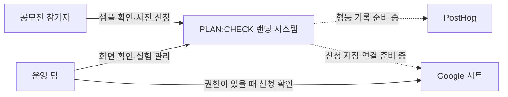
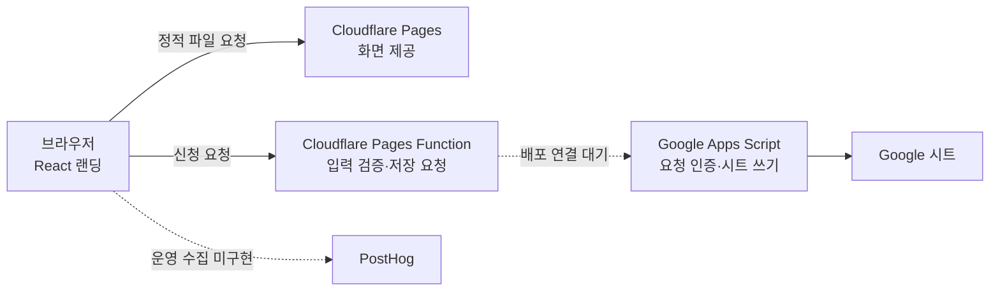

# PLAN:CHECK C4 구조

C4는 시스템을 서로 다른 거리에서 보는 설명 방식입니다. 이 문서는 **맥락 → 컨테이너 → 내부 구성 요소** 순서로 현재 구조를 보여 줍니다. 배포 경로는 [기술·배포 구조](technical-architecture.md)에 있습니다.

> 2026-11-21 기준. 테스트 사이트는 공개됐지만 배포 환경의 시트 연결과 실제 참가자 PostHog 수집은 미검증입니다.

## 1. 시스템 맥락: 누가 무엇과 연결되나요?

게시글 조회 수는 커뮤니티에서 확인해야 합니다. PostHog는 랜딩에 들어온 이후의 행동만 다루며, 게시글 조회나 실제 결제 완료를 알 수 없습니다.

## 2. 컨테이너: 시스템이 어떤 부분으로 나뉘나요?

브라우저는 방문자의 기기에서 실행됩니다. Cloudflare 함수는 서버에서 실행되어 이메일과 비밀값을 처리합니다. Apps Script와 시트, PostHog는 별도 서비스입니다.

## 3. 구성 요소: 각 부분의 책임은 무엇인가요?

| 부분 | 파일 | 책임 |
| --- | --- | --- |
| 화면 연결 | `src/plancheck/Prototype.tsx`, `original.html`, `interactions.js` | 팀 시안과 상호작용 연결 |
| 신청 폼 | `src/components/SignupForm.tsx` | 입력·동의, 저장 성공·실패 표시 |
| 행동 기록 | `src/analytics/` | 행동 이름과 속성 정의, 로컬 테스트 이벤트 생성 |
| 신청 서버 함수 | `functions/api/signup.js` | 출처·입력 검증, Apps Script 호출과 성공 응답 확인 |
| 시트 저장 | `scripts/apps-script/Code.gs` | 비밀값과 동의 확인, 시트에 한 행 저장 |

화면 문구나 위치를 바꾸더라도 같은 행동이면 같은 이벤트 기준을 유지합니다. 행동의 의미가 바뀌면 [이벤트 명세](events.md)와 테스트도 함께 수정합니다. 실제 전송 누락이나 데이터 중복까지 자동으로 사라지는 것은 아닙니다.

## 범위와 한계

- 실제 분석·피드백 제공, 사용자 계정, 결제와 구매 버튼은 현재 구현 범위에 없습니다.
- 신청 시트는 준비됐으나 현재 공개 테스트 사이트에서 실제 저장이 가능한 상태는 아닙니다.
- 로컬 PostHog 테스트에서만 가상 이벤트를 확인했습니다. 실험용 수집과 대시보드는 미완료입니다.
- 페이지 방문 ID는 한 페이지의 행동을 묶으며, 실제 사람이나 여러 기기의 방문을 정확히 식별하지 못합니다.
