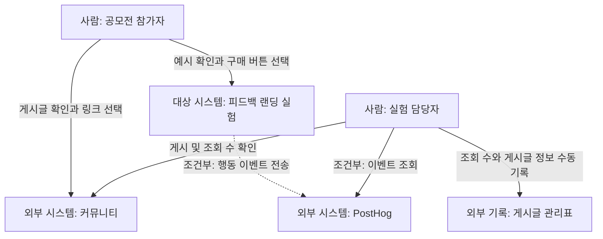
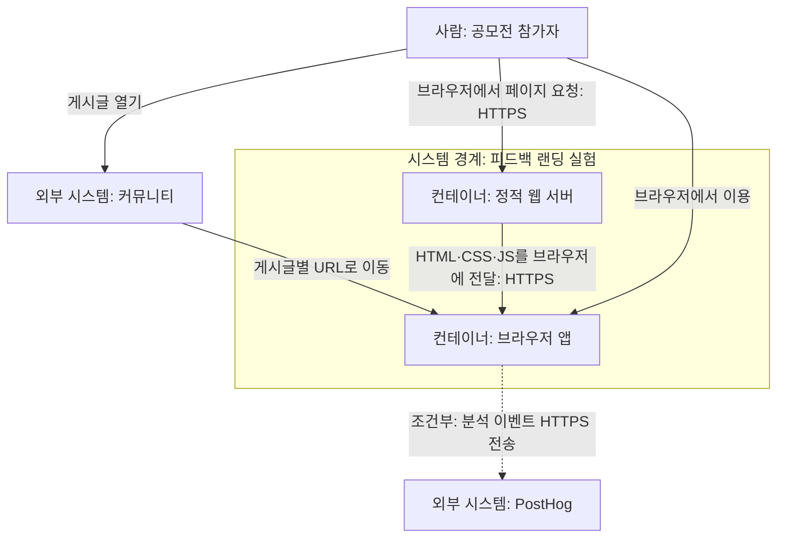
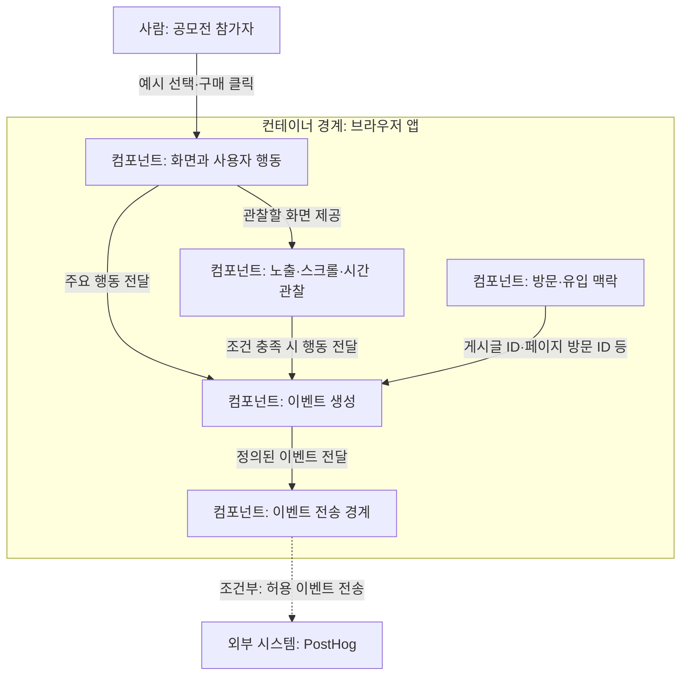

# 공모전 피드백 랜딩페이지 — C4 아키텍처 초안

> 검토용 목표 구조 · 2026-11-17. 배포나 실험 개시를 뜻하지 않습니다. 다이어그램은 수집 조건이 정해진 뒤의 **제안 구조**이며, 실제 구현 상태는 각 표에서 따로 표시합니다.

GitHub, React, Vite, Cloudflare와 PostHog의 기술·배포 연결은 [기술·배포 아키텍처](technical-architecture.md)를 참고하세요.

## 읽는 방법

| 수준 | 질문 | 이 문서의 대상 |
| --- | --- | --- |
| C1 시스템 맥락 | 누가 우리 시스템을 사용하고 어떤 외부 시스템과 연결되는가? | 전체 랜딩 실험 |
| C2 컨테이너 | 시스템이 어떤 실행·저장 단위로 구성되는가? | 정적 웹 서버와 브라우저 앱 |
| C3 컴포넌트 | 한 컨테이너 안에서 책임이 어떻게 나뉘는가? | 브라우저 앱 |
| C4 코드 | 클래스나 함수가 어떻게 구현되는가? | 이 문서에서는 생략 |

여기서 **컨테이너**는 Docker가 아니라 독립적으로 실행되거나 데이터를 저장하는 애플리케이션 단위입니다. C4 수준은 모두 그릴 필요가 없고 현재는 구현 세부사항보다 책임과 경계가 중요해 코드 수준을 생략합니다. 다이어그램은 호환성을 위해 Mermaid 흐름도 표기법으로 그린 C4 모델입니다.

**범위:** 이번 실험을 위한 랜딩 시스템만 대상으로 합니다. Cloudflare는 파일을 호스팅하는 외부 제공자이며, PostHog·커뮤니티·게시글 관리표는 시스템 밖입니다. 관리자 전용 웹 화면, 자체 API·데이터베이스·회원가입·이메일 수집·실제 결제·자동 분석은 범위에 없습니다. 이메일 관심 등록은 추후 별도 결정하며 구매 버튼과 독립적입니다.

**표기:** 사람·시스템·컨테이너·컴포넌트의 종류를 이름에 표시합니다. 실선은 제안하는 기능 관계이고, 점선과 `조건부`는 개인정보 처리 및 수집 범위가 정해진 후 구현할 관계입니다. 모든 다이어그램은 목표 구조이므로 실선도 이미 배포되었다는 의미는 아닙니다.

## C1. 시스템 맥락

참가자가 커뮤니티 게시글의 링크를 통해 랜딩 시스템에 도착합니다. 커뮤니티 조회 수는 담당자가 확인해 관리표에 기록합니다. PostHog 이벤트와 관리표를 사람이 게시글 ID와 기간에 맞춰 비교하며, 둘 사이에 자동 연동은 계획하지 않았습니다. 관리표의 형태와 위치는 미정입니다.

| 외부 대상 | 주고받는 정보 | 상태와 한계 |
| --- | --- | --- |
| 커뮤니티 | 게시글과 게시글별 링크, 플랫폼에서 제공하는 조회 수 | 채널·게시 기간 미정. 사이트가 조회 수를 직접 가져오지 않음 |
| PostHog | 허용된 방문·행동 이벤트, 담당자의 분석 조회 | 로컬 테스트 이벤트만 도착 확인. 실제 참가자 수집은 미구현 |
| 게시글 관리표 | 게시글 ID, 채널, 후킹 문구 버전, 게시 기간, 조회 수 | 도구·위치 미정. 사람이 수동 작성하고 분석에 활용 |

## C2. 컨테이너

| 컨테이너 | 실행·저장 위치 | 책임 | 현재 상태 |
| --- | --- | --- | --- |
| 정적 웹 서버 | 앞으로 Cloudflare Workers 정적 자산 호스팅 | 빌드한 HTML·CSS·JS 제공. 별도 서버 프로그램 없음 | 파일 생성은 가능. Cloudflare 연결·배포 전 |
| 브라우저 앱 | 방문자의 브라우저 | 화면 표시, 예시 선택, 구매 안내, 수집 조건 충족 시 이벤트 생성 | React + Vite 기능 확인용 화면 존재. 실제 방문자 수집은 꺼짐 |
| PostHog | 외부 분석 서비스 | 조건을 충족한 이벤트 저장·조회 | 로컬 테스트에만 연결. 실험 데이터 수집 미구현 |

화살표는 **요청·정보 전달의 방향**을 보여줍니다. 브라우저가 웹 파일을 요청하고 파일을 받아 앱을 실행합니다. 게시글의 URL은 앱 서버 호출이 아니라 방문자의 브라우저를 해당 주소로 이동시킵니다. Cloudflare가 PostHog로 이벤트를 보내는 구조는 아닙니다. 브라우저가 외부로 직접 보내게 될 경우 IP 등 네트워크 정보가 처리될 수 있습니다.

PostHog는 저장소 기능이 있지만 자체 데이터베이스는 아닙니다. 계정, 기획안, 이메일 또는 결제 정보를 저장할 컨테이너는 이 범위에 없습니다. 실제 이벤트 전송은 화면 기능과 독립적으로 실패하거나 차단될 수 있으며, 실패해도 예시와 구매 안내는 작동해야 합니다.

## C3. 브라우저 앱 컴포넌트

아래는 C2의 **브라우저 앱**을 확대한 논리적 책임 구조입니다. 각 상자가 반드시 별도의 파일이나 독립 서비스라는 뜻은 아닙니다. 현재 로컬 코드에서 대응하는 부분과 아직 없는 기능은 아래 표에 적었습니다.

| 책임 | 예시와 현재 코드 | 구현 상태 및 남은 작업 |
| --- | --- | --- |
| 화면과 사용자 행동 | `src/App.tsx`, `src/components/ExamplePreview.tsx` | 임시 화면과 구매 준비 중 안내 구현. 최종 디자인·가격·제공 범위 미정 |
| 방문·유입 맥락 | `src/analytics/campaign.ts`, `src/App.tsx` | URL의 UTM과 로컬 실습용 페이지 ID 처리. 실제 게시글 ID 허용 목록과 운영 측정 미구현 |
| 화면 관찰 | `src/analytics/useExposure.ts`, `src/analytics/usePageMetrics.ts` | 노출·스크롤·시간 등은 로컬 실습용. 최종 화면의 측정 기준과 실제 수집 방식은 재검토 필요 |
| 이벤트 생성 | `src/analytics/contracts.ts`, `src/analytics/tracker.ts` | 이름과 속성 형식 정의. 의미와 발생 기준은 `events.md`에서 관리 |
| 이벤트 전송 경계 | `src/analytics/tracker.ts`, `src/analytics/posthogTest.ts` | 기본 전송 비활성화. 명시적으로 켠 로컬 테스트 전송만 존재. 실제 수집 전 개인정보·환경 분리 설계 필요 |

화면은 “구매 버튼을 눌렀다”는 사실을 전달하고, 이벤트 생성 계층은 미리 정한 이름과 속성으로 기록합니다. 화면 배치가 바뀌어도 행동의 의미가 같으면 이름을 유지합니다. 반대로 의미나 발생 조건이 바뀌면 이벤트 명세와 버전·분석 기준을 함께 검토합니다. 팀에서 최종적으로 정할 디자인 구조를 이 그림이 제한하지는 않습니다.

### 로컬 테스트와 향후 실험의 차이

| 항목 | 지금: 로컬 테스트 | 향후: 참가자 대상 실험 제안 |
| --- | --- | --- |
| 실행 환경 | 개발자 로컬 브라우저 | 별도로 배포한 브라우저 앱 |
| 기본 수집 | 전송 안 함 | 수집 범위·고지·필요한 동의 결정과 구현 전까지 전송 안 함 |
| PostHog 연결 | 개발 모드와 명시적 테스트 설정에서만 가상 데이터 전송 | 별도 환경 구분·허용 데이터·전송 검증 필요 |
| 게시글 ID | 연습용 ID를 고정된 테스트 값으로 변환 | 발급한 실제 게시글 ID만 허용하는 방식 설계 필요 |
| 페이지 ID | 로컬 실습에서 페이지마다 임의 발급 | 페이지 방문 단위 집계에 활용하는 방안. 동일인 식별은 불가 |
| 이메일 | 수집 안 함 | 목적·관리자·보관·삭제 기준과 저장 방식 결정 전까지 보류 |

기존 테스트 이벤트 중 설정 변경 전에 저장된 IP와 위치 추정 정보가 남아 있습니다. 설정 변경 이후 테스트에서는 IP·위치 항목이 보이지 않았지만 네트워크상 IP 수신 자체가 차단된다는 뜻은 아닙니다. 기존 데이터 처리와 실제 참가자 데이터의 수집·국외 처리·보관·삭제 기준을 별도로 검토해야 합니다.

## 연결을 해석할 때

- 게시글별 유입률의 제안 기준은 **같은 기간의 해당 게시글 ID를 가진 페이지 방문 수 ÷ 커뮤니티에 표시된 해당 게시글 조회 수**입니다. 새로고침은 새 페이지 방문이며 조회·방문의 중복 기준이 다르므로 순수 클릭률이나 동일인 비율이 아닙니다.
- 구매 클릭은 실제 결제가 아닙니다. 버튼을 누를 때마다의 횟수와 한 번 이상 클릭한 페이지 방문 수를 구분합니다. 가격 미제시 상태에서는 가격을 모르는 상태의 관심 신호입니다.
- `page_view_id`는 페이지 내 이벤트를 묶을 뿐 같은 사람의 다른 기기·브라우저·재방문을 식별하지 못합니다. PostHog 기본 사용자·세션 퍼널과 같은 기준으로 가정하지 않고 집계를 검증합니다.
- 표시 시간과 전체 경과 시간은 다릅니다. 테스트에서는 누적 체크포인트의 합이 아니라 페이지 방문별 최댓값을 사용합니다. 전송 차단·종료·절전 등으로 누락되며 실제로 읽었는지는 알 수 없습니다.

## 변경 조건과 다음 설계

| 상황 | 다시 설계할 부분 |
| --- | --- |
| 이메일 관심 등록을 시작할 때 | 외부 폼과 자체 API·저장소 비교, 저장 성공 기준, 개인정보 안내·접근·삭제 |
| 실제 분석 로직이나 결제가 필요할 때 | 별도 백엔드·인증·저장소·결제 연동과 책임 경계 |
| 검색 유입이나 동적 서버 렌더링이 중요해질 때 | React + Vite 유지와 Next.js 등 대안 비교 |
| 최종 디자인이 정해졌을 때 | 노출 기준, 모바일 화면·접근성, 이벤트 의미와 버전 |
| 실제 참가자 수집을 준비할 때 | PostHog 자동 수집·식별자·IP·URL, 고지와 동의, 보관·삭제, 테스트와 실험 분리 |

다음으로는 이 구조를 기준으로 현재 코드가 담당하는 부분과 실험에 필요한 부분의 차이를 검토하고, 예시부터 구매 안내까지의 행동 및 이벤트 명세를 구체화합니다. 그 검토가 끝나기 전에는 이 그림을 구현 완료로 취급하지 않습니다.

관련 문서: [아키텍처 초안](architecture.md) · [이벤트 명세](events.md) · [실험 정리](experiment.md) · [팀 작업 방식](team-work.md)

참고: [C4 model 소개](https://c4model.com/introduction) · [C4 다이어그램 구성](https://c4model.com/diagrams)
