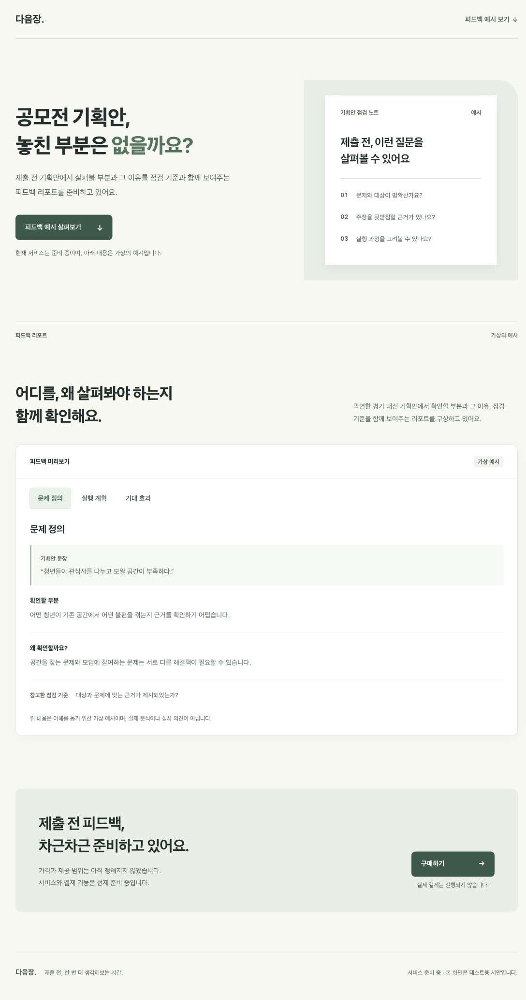
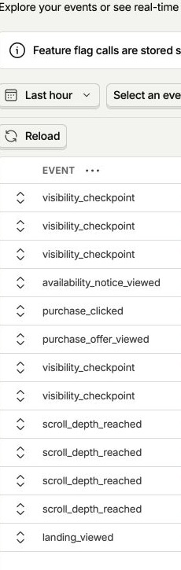

# 팀원을 위한 프로젝트 안내

> 2026년 11월 17일 기준 · 실험 준비 단계 · 화면과 숫자는 실제 서비스의 운영 결과가 아닙니다.

## 무엇을 만들고 있나요?

공모전 참가자가 제출 전에 기획안의 부족한 부분과 이유, 참고한 기준을 확인할 수 있는 피드백 서비스를 구상하고 있습니다. 우선 랜딩페이지를 통해 관심이 있는지 알아보려 합니다. 서비스의 효과는 아직 검증되지 않았습니다.

생각하고 있는 흐름은 **커뮤니티 게시글 → 랜딩페이지 → 피드백 예시 확인 → 구매 버튼 클릭**입니다. 구매 버튼 클릭은 관심을 보여주는 신호이며 실제 구매나 결제가 아닙니다.

## 지금 만든 랜딩페이지

위 이미지는 **현재 개발자 컴퓨터에서 실행한 화면을 캡처한 것**입니다. 피드백은 가상 예시이고, 디자인·문구는 팀 검토를 위한 임시안입니다. 실제 기획안 분석, 이메일 저장, 결제와 사이트 공개는 아직 준비되지 않았습니다. 구매 버튼을 누르면 준비 중이라는 안내가 나옵니다.

이전에 만들었던 [참고용 랜딩페이지 시안](https://next-draft-before-submit.bloomingglint4.chatgpt.site/)도 볼 수 있습니다. 위 캡처의 현재 로컬 화면과는 다른 시안이며, 실제 운영 사이트가 아닙니다.

## PostHog는 무엇인가요?

PostHog는 웹페이지에서 일어난 행동을 **기록하고 그래프로 살펴보는 도구**입니다. 아래는 실제 PostHog 프로젝트의 이벤트 목록 일부를 캡처한 것입니다. 개발자가 로컬에서 진행한 테스트이며, 실제 참가자의 행동이 아닙니다. 화면의 식별자 부분은 공유하지 않도록 제외했습니다.

| 화면에 보이는 이름 | 쉬운 설명 |
| --- | --- |
| `landing_viewed` | 랜딩페이지를 열었습니다. |
| `scroll_depth_reached` | 페이지를 일정 지점까지 내렸습니다. |
| `purchase_offer_viewed` | 구매 안내 영역이 정해진 기준에 따라 보였습니다. |
| `purchase_clicked` | 구매 버튼을 눌렀습니다. 결제는 아닙니다. |
| `availability_notice_viewed` | 서비스 준비 중 안내가 나타났습니다. |
| `visibility_checkpoint` | 페이지 경과 시간과 화면 표시 시간에 관한 중간 기록입니다. |

같은 행동을 여러 번 하면 기록도 여러 건 생길 수 있습니다. 따라서 기록 건수만으로 서로 다른 사람의 수를 알 수는 없습니다. 화면 표시 시간 역시 실제로 읽은 시간을 증명하지 않습니다.

### 대시보드는 어떻게 생겼나요?

이것은 **PostHog가 제공하는 기본 대시보드**입니다. 여러 그래프를 모아 볼 수 있다는 예시이며, 우리 실험에 맞게 설정한 대시보드는 아닙니다. 기본 그래프는 현재 테스트 이벤트와 기준이 달라 0 또는 일치하는 이벤트 없음으로 보일 수 있습니다. **0이 테스트 이벤트가 없었다는 뜻은 아닙니다.**

나중에 실험 기준을 정하면 방문, 예시 확인과 구매 클릭 등을 검토할 수 있도록 그래프와 단계별 분석을 구성할 예정입니다. 게시글 조회 수는 커뮤니티에서 별도로 확인해야 하며, 실제 측정 전에 개인정보와 데이터 보관 기준을 정해야 합니다.

## 팀에서 함께 정할 내용

- 피드백 예시와 참가자에게 전달할 문구
- 랜딩페이지 디자인과 구성
- 가격을 표시할지, 표시한다면 어떤 가격을 사용할지
- 게시글을 올릴 곳과 실험 기간
- 이메일 관심 등록의 필요성과 정보 수집·삭제 방법
- 결과를 어떤 기준으로 보고 해석할지

## 자료와 접근 방법

- [GitHub 저장소](https://github.com/HelloMyMe-M1-2/contest-feedback-landing): 코드와 문서가 있는 비공개 공간입니다. 초대를 수락해야 볼 수 있습니다.
- [프로젝트 첫 안내](../README.md): 현재 상태와 문서 목록을 볼 수 있습니다.
- [실험 정리](experiment.md): 실험 목적과 정해야 할 사항을 볼 수 있습니다.
- [PostHog 처음 사용하기](posthog-guide.md): 측정 도구와 로컬 테스트를 더 자세히 설명합니다.
- [PostHog 프로젝트](https://us.posthog.com/project/742481): 초대받은 계정으로 접속합니다. 현재는 개발 테스트 기록입니다.

GitHub에 접근한다고 랜딩페이지가 웹에 공개되는 것은 아닙니다. 현재 임시 화면을 직접 조작하려면 개발자 컴퓨터 또는 별도의 로컬 실행 환경이 필요합니다. 코드 실행 없이 위 이미지로 검토하거나 개발자에게 화면 공유를 요청할 수 있습니다.
