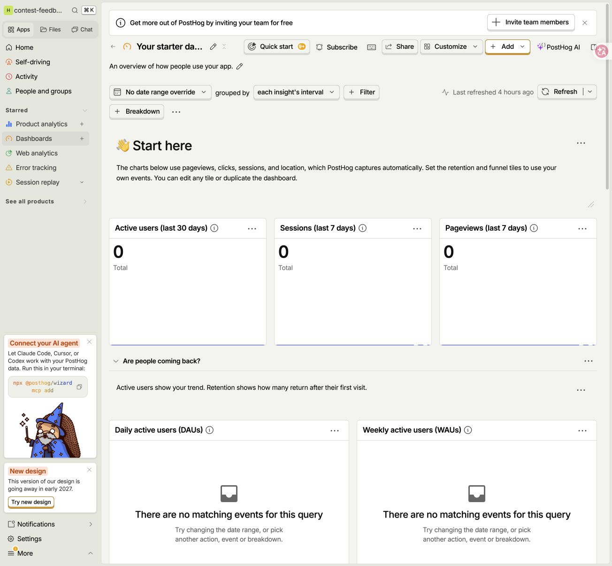

# 팀원을 위한 PLAN:CHECK 안내

> 2026-11-21 기준 · 테스트 화면 공개 · 실제 실험은 준비 중

## 무엇을 만들고 있나요?

공모전에 제출하기 전, 기획안의 부족한 부분과 그 이유를 확인하고 싶은 사람을 위한 피드백 서비스를 구상하고 있습니다. 우선 사람들이 이 서비스에 관심이 있는지 랜딩페이지로 알아보려고 합니다. 서비스의 실제 효과와 자동 분석 기능은 아직 검증되지 않았습니다.

**[현재 테스트 화면 보기](https://contest-feedback-landing.pages.dev/)**

팀이 만든 ZIP 시안의 흐름을 바탕으로 표지 → 공감 → 이용 방법 → 샘플 리포트 → 사전 신청 → FAQ를 배치했습니다. 샘플 리포트는 가상의 예시입니다. 현재 화면에는 구매 버튼이 없고 결제도 받지 않습니다.

테스트 주소는 누구나 열 수 있습니다. 다만 신청 시트와 연결되지 않았으므로 현재는 신청을 저장하지 못합니다. **실제 이메일이나 기획안을 입력하지 말아 주세요.**

## PostHog는 무엇인가요?

PostHog는 웹페이지에서 어떤 행동이 일어났는지 기록하고 그래프로 볼 수 있는 도구입니다. 예를 들어 방문, 샘플 리포트 노출, 신청 시작과 완료를 각각 볼 수 있도록 준비하고 있습니다.

위 이미지는 도구의 화면 형태를 보여주는 **기본 대시보드 예시**입니다. 현재 우리 실험에 맞게 구성된 결과 화면은 아닙니다. 개발자의 로컬 테스트 이벤트가 PostHog에 도착한 것은 확인했지만 실제 방문자의 행동은 아직 수집하지 않습니다.

한 사람이 같은 버튼을 여러 번 누르면 여러 건이 기록될 수 있습니다. 화면이 표시된 시간도 그동안 내용을 읽었다는 증거는 아닙니다. 게시글 조회 수는 커뮤니티에서 별도로 확인해야 합니다.

## 이메일은 어디서 확인하나요?

팀이 별도 관리자 화면 없이 Google 시트에서 신청 목록을 확인하는 방향입니다. 로컬에서는 가상 이메일로 저장을 시험했지만, 공개된 테스트 화면에서 시트로 이어지는 연결은 아직 검증하지 않았습니다. 시트는 권한을 받은 사람만 볼 수 있고, 팀원 초대는 담당자가 관리합니다.

PostHog에는 이메일 주소나 신청 폼에 입력한 내용을 보내지 않도록 설계했습니다. 신청 완료 행동과 신청자 목록의 숫자는 통신 실패나 중복 등으로 달라질 수 있습니다.

## 함께 확인할 내용

- 화면의 흐름과 샘플이 전달하려는 내용을 잘 보여 주는지
- 실제 실험 기간과 게시글을 올릴 채널
- 시트 접근 권한, 신청자 연락·보관·삭제 담당 방식
- 실제 수집을 시작하기 전 개인정보 안내와 측정 범위

## 바로가기

- [GitHub 저장소](https://github.com/HelloMyMe-M1-2/contest-feedback-landing): 코드와 문서
- [실험 준비 현황](experiment-readiness.md): 확인된 것과 남은 작업
- [이벤트 명세](events.md): 어떤 행동을 어떤 기준으로 셀지
- [PostHog 프로젝트](https://us.posthog.com/project/742481): 권한이 있는 팀원이 테스트 기록을 확인하는 곳
- [PostHog 대시보드 안내](posthog-dashboard.md): 대시보드와 내보내기 설명
