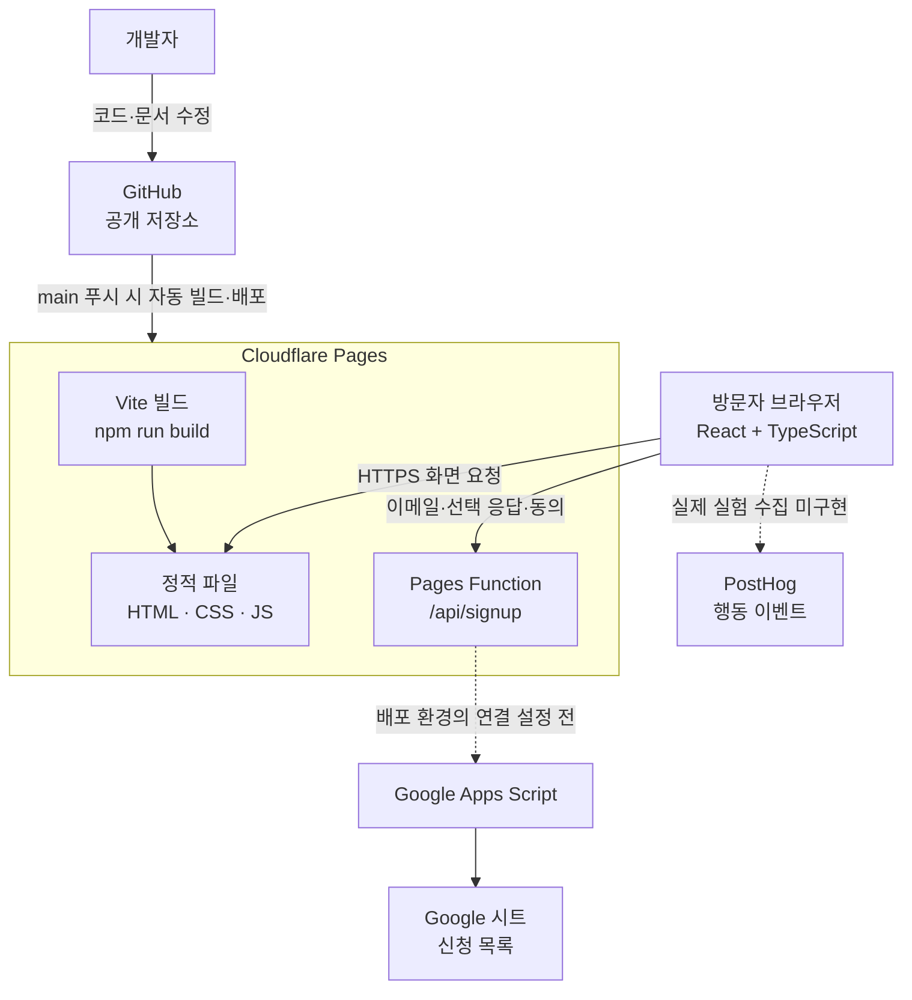

# PLAN:CHECK 기술·배포 구조

> 2026-11-21 기준. 테스트 사이트는 공개되어 있습니다. 실제 이메일 접수와 참가자 행동 측정은 아직 연결·검증 중입니다.

## 전체 흐름

**실선**은 현재 구성했거나 설계한 호출 관계이고, **점선**은 실제 배포 환경에서 아직 연결되지 않은 경로입니다. Google 시트와 PostHog는 서로 다른 목적을 가집니다. Google 시트에는 신청 목록을 저장하고, PostHog에는 이메일 없이 행동 이벤트만 보내는 방향입니다.

## 구성 요소별 상태

| 구성 요소 | 하는 일 | 현재 확인 상태 |
| --- | --- | --- |
| GitHub | 코드와 팀 문서 관리 | 공개 저장소. `main`에 푸시하면 Cloudflare에서 자동 배포 |
| React · TypeScript · Vite | 화면 표시, 동작 연결, 브라우저용 파일 생성 | 팀 전달 시안을 연결한 테스트 화면. 원본 스크립트 어댑터 일부 유지 |
| Cloudflare Pages | 공개 테스트 화면 제공과 서버 함수 실행 | 테스트 사이트 빌드·배포 성공. 별도 관리 서버를 운영하지 않음 |
| Pages Function | 신청 입력 검증 후 Apps Script에 요청 | 배포됨. Cloudflare의 연결 설정과 실제 Google 통신은 아직 미검증 |
| Apps Script · Google 시트 | 인증된 요청을 처리해 신청 행 저장 | 웹 앱 설정 및 로컬 가상 신청의 시트 저장 확인. 팀원 시트 권한은 담당자가 관리 |
| PostHog | 방문과 행동 이벤트 분석 | 로컬 테스트 이벤트만 도착 확인. 배포 테스트는 별도 설정과 전용 쿼리로만 활성화되며 미검증. 실제 참가자 수집은 미연결 |

신청 처리는 정적 파일만으로 끝나지 않습니다. 입력을 검증하고 서버 전용 비밀값으로 Apps Script에 요청하는 **Cloudflare 서버 함수**가 필요합니다. 팀이 서버 프로그램을 직접 유지할 필요는 없지만, 서버 측 코드와 연결 설정은 존재합니다.

## 신청 흐름

1. 방문자가 이메일, 선택 가능한 공모전 준비 단계와 필수 동의를 입력합니다.
2. 서버 함수가 출처와 입력값을 확인하고 Apps Script에 요청합니다.
3. Apps Script가 비밀값을 확인한 뒤 Google 시트에 신청 시각·이메일·선택 응답·동의 버전을 저장합니다.
4. 저장 성공 응답을 확인한 경우에만 완료 화면을 표시합니다. 실패하거나 성공 여부를 확인하지 못하면 오류를 표시합니다.

로컬 Node 경로에서는 가상 신청 저장을 확인했습니다. 로컬 Cloudflare 실행기에서는 외부 요청 오류가 발생해 Cloudflare 배포 환경에서의 실제 Google 연결은 아직 확인하지 못했습니다. 저장 이후 응답이 끊기면 재신청으로 중복될 수 있습니다. 상세 내용은 [사전 신청 설계](signup-design.md)를 봅니다.

## 행동 측정 흐름

개발자 테스트에서는 화면 행동을 `tracker`가 정해진 이벤트로 만들고 PostHog 테스트 전송 코드가 허용한 속성만 보냅니다. 공개 테스트 화면의 일반 접속은 PostHog로 이벤트를 보내지 않습니다. 별도로 빌드 설정과 전용 쿼리를 갖춘 배포 테스트 전송은 아직 미검증입니다. 실제 참가자 측정을 시작하려면 운영 수집 설정, 개인정보 안내·필요한 동의, 테스트 분리와 실제 전송 검증이 남아 있습니다. [이벤트 명세](events.md)

## 파일 위치

| 위치 | 역할 |
| --- | --- |
| `src/plancheck/` | 팀 전달 원본 HTML·CSS 및 React 연결과 상호작용 |
| `src/components/SignupForm.tsx` | 사전 신청 폼 |
| `src/analytics/` | 이벤트 정의, 화면 관찰, 로컬 PostHog 테스트 |
| `functions/api/signup.js` | Cloudflare 신청 서버 함수 |
| `scripts/apps-script/Code.gs` | Google 시트 저장 스크립트 |
| `docs/` | 팀 안내와 설계 기록 |

비밀값은 로컬 `.dev.vars` 또는 Cloudflare의 서버 전용 Secret으로 관리하며 공개 저장소와 브라우저 코드에 넣지 않습니다. `VITE_`로 시작하는 변수는 브라우저에 노출됩니다.

## 배포할 때 알아둘 점

- Cloudflare Pages가 GitHub `main`을 감지해 `npm run build` 후 배포합니다. 푸시가 곧 공개 테스트 화면의 변경으로 이어집니다.
- 배포 주소는 기본적으로 공개됩니다. 별도 접근 제한 없이는 팀 내부 전용이라고 가정하지 않습니다.
- 테스트 사이트의 빌드 성공은 신청 시트 연결이나 실제 행동 측정 성공을 뜻하지 않습니다.
- 신청 URL·공유 비밀값, 실제 이메일, 사용자 기획안은 저장소·이슈·스크린샷에 넣지 않습니다.

시스템 범위와 컴포넌트 관점은 [C4 구조](c4-architecture.md)를 참고하세요.
