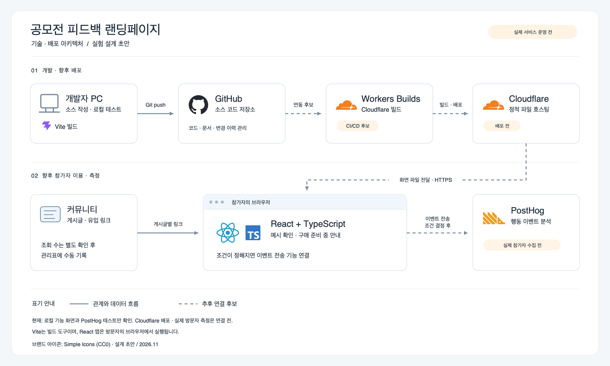
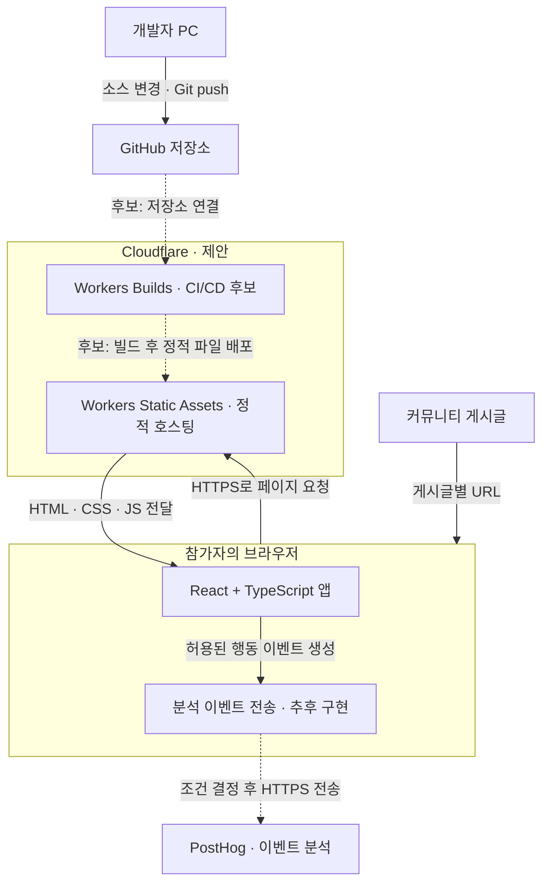

# 랜딩페이지 기술·배포 아키텍처 초안

> 2026-11-21 현재 Cloudflare에 공개 테스트 화면이 배포되어 있으며 GitHub `main` 변경은 자동 배포됩니다. 실제 신청 시트 연결과 참가자 분석 수집은 아직 준비 중입니다. 아래 그림과 본문의 연결 상태는 2026-11-17 당시 제안이므로 최신 상태는 [실험 준비 안내](experiment-readiness.md)를 확인하세요.

## 전체 구성

확대하거나 수정할 때는 [SVG 원본](images/technical-architecture.svg)을 사용할 수 있습니다. 브랜드 아이콘은 [Simple Icons](https://simpleicons.org/)를 사용했습니다.

### 텍스트로 보는 연결

실선은 구성 요소 간 역할을 설명합니다. 점선은 **향후 구현·설정 후보**입니다. 실선이라고 현재 전체 경로가 배포되었거나 실제 참가자에게 작동한다는 뜻은 아닙니다. GitHub–Cloudflare 연결 및 빌드·배포 방식은 아직 설정하지 않았습니다. 방문자가 커뮤니티 링크를 열면 브라우저가 Cloudflare에 파일을 요청하는 흐름입니다.

### 기술별 역할과 상태

| 기술·구성 | 하는 일 | 지금 상태 |
| --- | --- | --- |
| GitHub | 소스 코드와 문서 이력 관리 | 조직 저장소 사용 중. 로컬 미커밋 변경 사항 존재 |
| React | 브라우저에서 예시·버튼·안내를 보여주는 UI 라이브러리 | 기능 확인용 화면 구현. 최종 디자인은 미정 |
| TypeScript | 코드에서 이벤트 속성 등의 형식 검사 | 프로젝트에 사용 중 |
| Vite | 개발 서버 실행과 브라우저용 파일 빌드 | 프로젝트에 사용 중. `npm run build`는 타입 검사 후 Vite 빌드 |
| Cloudflare Workers Static Assets | 빌드된 정적 파일을 HTTPS로 제공 | 사용하기로 했으나 계정 연결·설정·배포 전 |
| Cloudflare Workers Builds | GitHub와 연계한 빌드·배포 자동화 후보 | 미설정·미확정. 연결 시 자동 배포가 생길 수 있어 브랜치와 공개 범위 설정 필요 |
| `posthog-js` | 브라우저에서 PostHog로 이벤트를 보내는 SDK | 명시적인 개발자 로컬 테스트에서만 사용. 실제 참가자 전송은 미구현 |
| PostHog | 수집된 이벤트의 저장과 분석 | 개발자 로컬 테스트 데이터 도착 확인. 실제 참가자 데이터는 수집 전 |

## 제안하는 연결 흐름

1. **개발:** 개발자가 React·TypeScript 코드를 수정하고 로컬에서 실행·검증합니다. Vite가 브라우저에서 사용할 정적 파일을 빌드합니다.
2. **버전 관리:** 검토한 변경 사항을 GitHub 저장소에 올립니다. 현재 로컬 변경 사항이 이미 원격 저장소에 반영되었다고 가정하지 않습니다.
3. **향후 빌드·배포:** GitHub와 Cloudflare Workers Builds를 연결하는 방안을 우선 추천합니다. 연결한 경우 테스트·빌드 명령과 배포 대상 브랜치·미리보기 접근 범위를 별도로 설정하고 검증해야 합니다. 아직 CI나 CD는 연결되지 않았습니다.
4. **페이지 제공:** 향후 배포된 정적 파일을 Cloudflare가 브라우저에 HTTPS로 전달합니다. React 앱은 참가자의 브라우저에서 실행됩니다. 이 구성에 React를 실행하는 자체 백엔드 서버는 없습니다.
5. **분석:** 향후 처리 조건이 마련되면 브라우저에서 PostHog로 허용된 이벤트를 직접 보냅니다. 이 연결이 막히거나 실패해도 예시 선택과 구매 안내는 작동해야 합니다. 현재 실제 참가자 데이터는 보내지 않습니다.
6. **게시글 집계:** 게시글 조회 수는 커뮤니티에서 담당자가 확인해 관리표에 수동으로 기록합니다. PostHog와 관리표를 자동으로 합치는 시스템은 없습니다.

## CI/CD 선택지

| 방식 | 장점 | 고려할 점 | 현재 판단 |
| --- | --- | --- | --- |
| Cloudflare Workers Builds의 GitHub 연동 | 정적 사이트의 빌드·배포 경로가 짧고 구성 요소가 적음 | 저장소 접근 권한, 배포 트리거, 브랜치·미리보기 공개 범위 확인 필요 | 향후 우선 검토 후보. 지금은 미연결 |
| GitHub Actions에서 빌드·배포 | 테스트, 조건부 배포 등 워크플로 제어에 유연 | 워크플로와 Cloudflare 인증 정보 관리 필요 | 세밀한 제어가 필요해지면 비교 |
| 로컬에서 직접 빌드·수동 배포 | 처음에는 흐름을 이해하기 쉽고 자동 배포가 없음 | 작업자 환경과 수동 절차에 의존 | 초기 검증의 대안 |

두 자동화 도구를 반드시 함께 쓸 필요는 없습니다. 자동화 여부, `npm test` 실행 위치, 실패 시 배포 차단과 브랜치별 정책은 나중에 결정합니다. 팀 검토용 주소도 접근 제한을 별도로 확인하기 전까지 비공개라고 가정하지 않습니다.

## 데이터 경계와 미결정 사항

- **PostHog:** 개발용 로컬 테스트 외의 전송 경로는 아직 없습니다. 기존 테스트 중 설정 변경 전에 저장된 IP와 위치 추정 정보가 남아 있어 처리 방침을 정해야 합니다. 실제 참가자 분석 전 자동 수집, IP, URL, 식별자, 필요한 고지·동의, 국외 처리와 보관·삭제를 확인합니다.
- **이메일 관심 등록:** 구매 클릭과 독립적인 경로입니다. 연락 목적·책임자·보관·삭제 기준이 정해지기 전까지 수집하지 않습니다. 나중에 필요하면 외부 폼과 자체 API·저장소를 비교하고 이 그림을 확장합니다.
- **결제와 자동 분석:** 현재 실험에 없습니다. 구매 버튼은 준비 중 안내를 표시하고 클릭은 관심 신호로만 해석합니다.
- **방문·기기 식별:** 페이지 방문 ID와 PostHog 세션·실제 사람은 서로 다른 개념입니다. 이벤트별 집계 기준과 누락 한계는 [이벤트 명세](events.md)에서 관리합니다.

## C4 모델과의 관계

이 그림은 C4 모델의 **배포 관점**을 참고해 기술과 인프라의 연결을 설명한 것입니다. 엄밀한 C4 단일 수준 도표라기보다는 이해를 돕기 위해 개발·배포와 실행 흐름을 함께 보여줍니다. 시스템 경계, 컨테이너, 브라우저 내부 책임은 [C4 아키텍처](c4-architecture.md)를 참고하세요.

참고: [Cloudflare Workers Git 연동](https://developers.cloudflare.com/workers/ci-cd/builds/git-integration/) · [Cloudflare 정적 파일 배포](https://developers.cloudflare.com/workers/static-assets/) · [C4 배포 다이어그램](https://c4model.com/diagrams/deployment)
